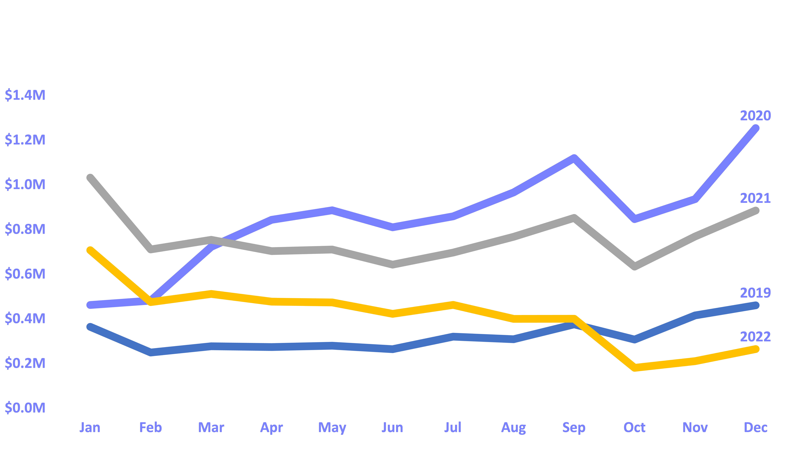
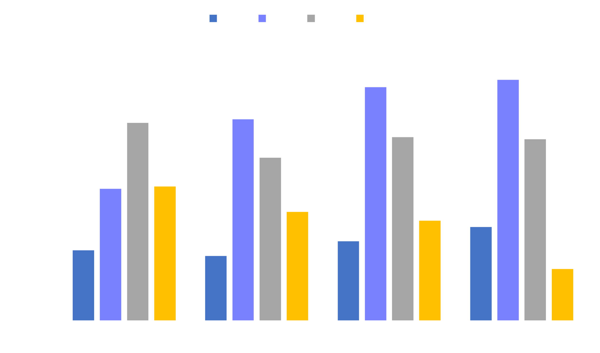
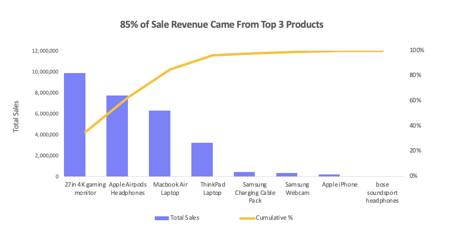
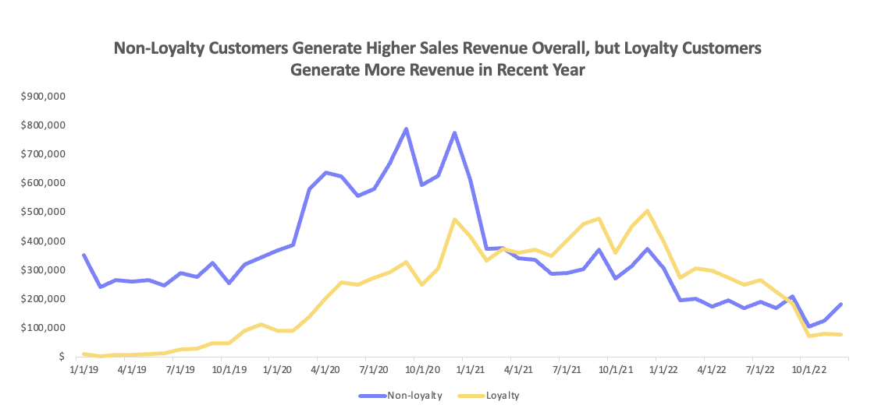
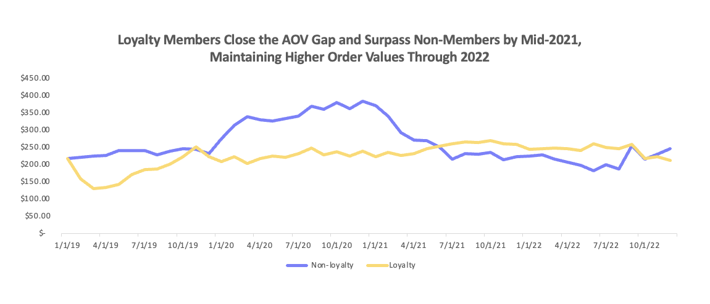

# 
 E-COMMERCE PERFORMANCE ANALYSIS 

 

# Company Background
Established in 2018, FuturTech is a global e-commerce retailer specializing in electronic devices, including laptops, gaming monitors, and accessories. Serving students, working professionals, and gamers across 191 countries, the company offers premium products at competitive prices in an increasingly competitive electronics market.

This analysis evaluates FuturTech’s sales performance from 2019 to 2022 using 108,000 records from 88,000 unique customers. It aims to identify key sales drivers and opportunities to sustain revenue growth after the pandemic. The analysis focuses on four areas:
- **Overall Sales Trends**: Analyze Year-over-Year (YoY), Quarterly, and Month-over-Month performance to identify growth patterns and seasonality using total revenue, average order value (AOV) and number of sales. 
- **Product and Brand Performance**: Evaluate product categories, brand contribution, and refund rates to guide portfolio expansion and inventory planning.
 - **Loyalty Program Evaluation**: Assess the program’s effectiveness in driving customer retention, engagement, and repeat purchases.
- **Regional Performance**: Identify underperforming markets and growth opportunities through targeted marketing and brand awareness campaigns.

# Executive Summary 
<h2 align="center">Sales Revenue Analysis (2019-2022)</h2>

<table align="center" width="90%">
  <tr>
    <td align="center" width="500">
      <h3>💰 Total Revenue</h3>
      <h2>$28.12M</h2>
    </td>
    <td align="center" width="500">
      <h3>🛒 Average Order Value</h3>
      <h2>$260</h2>
    </td>
    <td align="center" width="500">
      <h3>📦 Total Orders</h3>
      <h2>108,124</h2>
    </td>
  </tr>
</table>

  

# Insight Deep-Dive 

<table>
  <tr>
    <td align="center" width="750">
      <strong>2020 Was The Strongest Performance Year, Followed by a Slowdown in 2021 and a Significant Decline in 2022. 
      </strong>
      
    </td>
    <td align="center" width="750">
      <strong>Q4 Led in 2019–2020, While Q1 Took the Lead in 2021–2022.</strong>
      
    </td>
  </tr>
</table>

## Sale Performance 
#### Year-over-Year (YoY) Analysis
- **Historical benchmark (2019 - 2022)**: FuturTech generated an average of $7M in annual revenue, with 27K orders and an average AOV of $254.
- **Strongest growth (2020)**: Revenue surged 163% and number of orders grew by 101% YoY, potentially driven by pandemic related shift toward ecommerce and work-from-home demand. 
- **Sharpest decline (2022)**: Revenue fell 46%, following a 10% decline in 2021, potentially reflecting post-pandemic demand normalization and a return to in-store shopping. 

#### Quarterly Performance Analysis 
- **Q3 and Q4 were the strongest performing quarters**: Q3 generated the highest cumulative revenue ($7.5M) and order volume (28K+), while Q4 recorded the highest AOV ($265), potentially driven by holiday shopping demand (Black Friday, Cyber Monday, Christmas) 
- **Quarterly sales patterns shift after 2020**: Q4 led in 2019-2020, while Q1 became the strongest quarter in 2021-2022, suggesting changing post-pandemic purchasing patterns.
- **Q4 experienced a significant decline in 2022**: Revenue dropped 72% from $2.28M in 2021 to $649K in 2022.
- **Q2 Slowdown**: Q2 underperformed highlighting an opportunity to stimulate mid-year demand through targeted promotions

#### Month-over-Month (MoM) Analysis 
- **Peak vs. Lowest Performance**: December 2020 peaked at $1.2M in revenue and 4K orders, compared to December 2022’s low of $262K and 1.1K orders.
- **Revenue Growth and Decline**: March 2020 saw the highest MoM revenue increase (+50%), while October 2022 recorded the steepest drop (-55%).
- **Seasonality**: September showed strong sales, followed by an October slowdown and a recovery in November and December.

## Product Performance 

  

- **Revenue Concentration**: The top three products are ASUS 27-inch 4K Gaming Monitor, Apple AirPods, and MacBook Air, generating approximately 80% of total revenue, highlighting FuturTech’s reliance on a limited product portfolio.
- **Product Demand & Revenue Opportunity**: The gaming monitor generates the highest revenue, AirPods the most orders, and MacBook Air the highest AOV. Samsung accessories rank among the popular products but contribute only 3% of revenue, presenting an opportunity to explore bundling and higher-value products.
- **Product Sales Anomaly**: Apple iPhone was thought to be a popular product, but it contributes only 1% to total revenue, compared with AirPods (28%) and MacBook Air (22%). This unexpected gap needs further investigation. 
- **Bose Headphones** was among the worst-performing products, with low sales volume and a 91% revenue decline. 
- **Refund Risk**: MacBook Air and ThinkPad recorded refund rates of 11% and 12%, respectively, with approximately $1M in combined refund value, highlighting the need to investigate refund reasons and potential product quality issues.

## Regional Performance 
- **Revenue Concentration**: North America leads with $14M (52% of revenue), followed by EMEA at 29% with both regions accounting for 80% of total sales
- **APAC Has High-Value Customers**: APAC has the highest AOV ($279),while Japan and India customers spend $130 and $36 more per order, respectively than US customers.
- **LATAM is Underperforming**: The region ranks lowest across all sales metrics, presenting an opportunity for localized marketing, market research and competitive pricing to drive growth. 
- **Key Markets**: 12 countries account for 80% of revenue, with the US leading at $13M and 50K orders 

## Loyalty Program 
<table>
  <tr>
    <td align="center">
      <strong>Loyalty Sales Trend</strong> 
      
    </td>
    <td align="center">
      <strong>Loyalty AOV Trend</strong> 
      
    </td>
  </tr>
</table>

- **Non-Loyalty Customers Spend More Overall**: Non-loyalty customers generated $17M in sales and spent $35 more per order on average ($275 vs. $240) 
- **Higher Spending Among Loyalty Members After Mid-2021**: From July 2021 onward, loyalty members spent more per order than non-loyalty members, suggesting increased program adoption and engagement after its rollout in 2019. 

# Recommendations 
### Head of Operations 
- **Optimize Inventory Planning for peak seasons Q3 and Q4 for top three performing products**
  - Prioritize inventory planning for the top three revenue generating products: Asus 27in 4k gaming monitor, Apple Airpods, and Macbook Air, contribute 80% of total revenue 
  - Q3 generated the highest quarterly revenue at $7.5M and over 28K orders, indicate strong demand during this period
  - Q4 recorded the highest AOV at $265, highlighting an opportunity to promote premium products.
    
- **Investigate laptop refund issues to improve product quality and customer satisfaction**
  - Macbook Air and ThinkPad recorded refund rates of 11% and 12% respectively, with $1M in combined refund value.
  - Communicate with retailers to understand product-related return issues
  - Conduct customer surveys to identify the main reasons behind returns.

- **Expand Samsung’s Product Portfolio and Assortment** 
  - Existing Brand Performance: Samsung charging cable packs and webcams generate 29K orders, making Samsung the second best-selling brand after Apple, but contribute only 3% of total revenue due to their low price points. 
  - Expand into Higher-Value Products: Explore adding higher-value products such as laptops and foldable smartphones to build on existing demand and increase Samsung’s revenue contribution 
  - Bundle existing best sellers: bundle popular Samsung accessories to encourage multi-product purchases and increase AOV.  

- **Re-evaluate Bose and Apple Iphone** 
  - Bose Headphones: Given their 91% revenue decline and low sales volume, review whether FuturTech should continue carrying Bose headphones
  - Apple Iphone: Despite Apple’s strong overall brand performance, Iphone contributes only 1% of total revenue, compared with 28% from Airpods and 22% from Macbook Air. 
  - Investigate reasons behind its low sales contribution and evaluate opportunities to improve Apple Iphone positioning.

### Sales Team 
- **Investigate the significant revenue decline in December 2022.**
  - December 2022 revenue dropped to $262K, compared with $1.2M in December 2020
- **Conduct Market Research for Samsung Expansion**
  - Identify key markets for Samsung sales for the Marketing team to make regional campaigns and promotions. 
- **Targeted APAC region for premium products**
  - APAC recorded the highest AOV at $279, with Japan and India customers spending $130 and $30 more per order than US customers 
- **Exploring strategies to improve underperforming region LATAM, which ranked lowest across key metrics.**

### Marketing Team 
- **Continue the Loyalty Program and Introduce an Exclusive Trade-In Program**
  - By 2022, loyalty members made more purchases and spend $30 more per order than loyalty customers 
  - Explore a trade-in program offering eligible members credit toward newer devices,  targeting key markets: US, UK, Canada, Australia, and Japan to encourage repeat purchases and device upgrades. 

- **Boost Mid-Year Sales by increase promotional activities during Q2 to improve sales during historically weaker periods.** 

